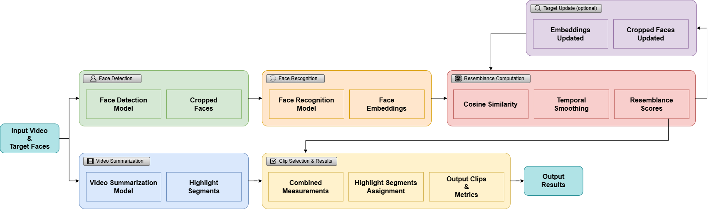

# Personalized Video Summarization (PVS)

An end-to-end system for generating personalized video summaries by combining text-guided video summarization with face recognition to identify and extract highlights of specific people in sports videos.

## Overview

The PVS pipeline addresses a key challenge in sports video analysis: automatically finding and extracting highlights featuring specific athletes from full-length broadcasts. The system integrates two complementary processing streams—video summarization and face analysis—to produce identity-aware highlight clips.

**Key Idea**: Athletes are often most visible outside their actual performance moments (during preparation, celebrations, or transitions), while their faces may be small, distant, or occluded during the action. PVS handles this temporal misalignment by analyzing faces across the entire video and intelligently associating identity evidence with highlight segments.



The pipeline consists of two parallel streams that operate independently before being fused:

1. **Face-Analysis Stream** (top): Detects faces in every frame, extracts embeddings, computes temporal resemblance curves, and optionally refines target representations using in-video matches
2. **Video-Summarization Stream** (bottom): Identifies narratively salient segments using text-guided models
3. **Clip Selection** (final stage): Fuses identity evidence with highlight segments using assignment algorithms that handle temporal misalignment

## Architecture

### Face-Analysis Stream


The face-analysis stream processes the full video to determine when and where each target person appears:

1. **Face Detection** - Detects and crops all visible faces using SCRFD detector
2. **Face Recognition** - Extracts embeddings from face crops using:
   - **ArcFace**: CNN-based, margin-loss model (99.63% LFW accuracy)
   - **TransFace**: Transformer-based model with better occlusion handling
3. **Target Update** (optional) - Finds the best in-video match for each target to improve domain alignment
4. **Resemblance Computation** - Computes frame-level cosine similarity and applies temporal smoothing to produce resemblance curves

**Output**: Temporal resemblance curves showing when each target appears in the video with what confidence.

### Video-Summarization Stream


The video-summarization stream identifies narratively salient segments using text guidance:

- **SportCLIP**: Uses CLIP embeddings with positive/negative text prompts to score frames based on text-video matching
- **QD-DETR**: Uses transformer-based query-conditioned moment retrieval with natural language queries

Both models produce per-frame saliency scores that are post-processed into discrete highlight segments.

**Output**: Frame-indexed highlight segments with timestamps and metadata.

### Clip Selection & Assignment


The final stage assigns highlight segments to specific athletes using two complementary algorithms:

#### Method 1: Sequential Assignment
- Scans timeline left-to-right
- Looks back 5 seconds before each highlight to identify the athlete
- Propagates assignment forward until new evidence appears
- **Best for**: Videos where athletes are shown in close-up before their performance

#### Method 2: Instant Assignment with Temporal Expansion
- Evaluates each highlight independently
- Expands search window by ±3 seconds around the segment
- Assigns to athlete with highest average resemblance score
- **Best for**: Videos where athletes appear after performance (celebrations, reactions) or when recognition is unreliable

Both methods process ArcFace and TransFace independently, enabling direct comparison of CNN vs. Transformer-based face recognition under identical conditions.

## Key Features

- **Separation of Concerns**: Video summarization and identity analysis operate independently, enabling modular comparison of different models
- **Full-Video Identity Grounding**: Analyzes faces across the entire video, not just inside highlight segments
- **Multi-Model Support**: Compares ArcFace (CNN) vs. TransFace (Transformer) and SportCLIP vs. QD-DETR
- **Target Adaptation**: Optional target update finds best in-video match to improve recognition accuracy
- **Temporal Misalignment Handling**: Two assignment algorithms designed for different broadcast patterns
- **Interpretable Output**: Generates temporal resemblance curves and assignment visualizations showing the system's decision-making process

## Installation

### 1. Install Python Dependencies

```bash
pip install -r requirements.txt
```

### 2. Set Up Target Face Images

Organize target face images in video-specific subdirectories:

```
target_faces/
├── highjump_video1/
│   ├── athlete1.jpg
│   └── athlete2.jpg
└── longjump_video1/
    ├── athlete1.jpg
    └── athlete2.jpg
```

- Use clear, frontal face images
- Supported formats: `.jpg`, `.png`, `.jpeg`

### 3. Place Input Videos

Place videos in the `data/` directory (`.mp4`, `.avi`, `.mov`, `.mkv`).

### 4. GPU Setup (for Face Detection)

Face detection requires GPU acceleration. Use the provided wrapper script:

```bash
./run_with_cuda.sh python extract_all_faces.py
```

This script handles CUDA library compatibility (system CUDA 13.0 vs. onnxruntime-gpu CUDA 12.x requirements).

## Quick Start

### Complete Pipeline (Recommended)

Run the entire pipeline on a single video:

```bash
# With QD-DETR summarization
python main.py --video highjump_video1 \
    --video-summarizer qddetr \
    --qddetr-query "high jump attempts"

# With SportCLIP summarization
python main.py --video longjump_video1 \
    --video-summarizer sportclip \
    --sentences-file data/sentences/long_jump.json
```

This executes all pipeline stages:
1. Generate video summaries → `video_summaries/`
2. Extract faces from full video → `cropped_faces/`
3. Extract embeddings (ArcFace + TransFace) → `cropped_faces_embeddings/`
4. Extract embeddings from original target images
5. Compute resemblance curves → `resemblance_results/`
6. Create visualizations and copy clips → `results/`

### Target Update Mode

To find the best in-video match and use it as an updated target reference:

```bash
python main.py --video highjump_video1 \
    --video-summarizer qddetr \
    --qddetr-query "high jump attempts" \
    --use-updated-target
```

**Comparison**:
- **Without flag**: Max similarity ~80-90% (comparing original target vs. video faces)
- **With flag**: Max similarity ~100% (comparing updated target vs. itself in video)

Files with `_updated` suffix are created to preserve both versions.

### Model Selection

```bash
# Use only ArcFace
python main.py --video highjump_video1 \
    --video-summarizer qddetr \
    --qddetr-query "high jump attempts" \
    --face-recognition-models arcface

# Use only TransFace
python main.py --video highjump_video1 \
    --video-summarizer qddetr \
    --qddetr-query "high jump attempts" \
    --face-recognition-models transface

# Use both (default)
python main.py --video highjump_video1 \
    --video-summarizer qddetr \
    --qddetr-query "high jump attempts" \
    --face-recognition-models arcface transface
```

Each model creates separate output folders (`ArcFace_highlight_clips/` and `TransFace_highlight_clips/`) for easy comparison.

## Pipeline Components

### 1. Video Summarization

Generate highlight clips independently:

```bash
# SportCLIP
python generate_video_summaries.py --model sportclip \
    --sentences-file data/sentences/long_jump.json

# QD-DETR
python generate_video_summaries.py --model qddetr \
    --video highjump_video1 \
    --qddetr-query "highlight moments in high jump"
```

**Output**: `video_summaries/<model>/<video>/` with clips and `segments.json` metadata.

### 2. Face Detection

Extract faces from all video frames:

```bash
./run_with_cuda.sh python extract_all_faces.py --min-face-size 50
```

**Output**: `cropped_faces/` with face crops and `face_detections.json` containing bounding boxes, landmarks, and confidence scores.

### 3. Face Embedding Extraction

Extract embeddings using unified script with different modes:

```bash
# Extract embeddings from all video faces (default)
python extract_embeddings.py --mode video_faces

# Extract embeddings from original target images
python extract_embeddings.py --mode original_targets

# Extract embeddings from updated targets (requires prior target update)
python extract_embeddings.py --mode updated_targets --video highjump_video1
```

**Features**:
- Progressive saving (every 1000 embeddings)
- Resume support (skips already processed faces)
- HDF5 format for efficient storage

### 4. Target Update (Optional)

Find best matching face in video for each target:

```bash
python find_updated_target.py --target athlete1 --video highjump_video1
```

**Output**: `target_faces_updated/<video>/<target>/` with updated crops, embeddings, and matching log.

### 5. Resemblance Curve Computation

Generate temporal resemblance curves:

```bash
# Process all targets for a video
python compute_resemblance_curve.py --video highjump_video1

# Process specific target
python compute_resemblance_curve.py --target athlete1 --video highjump_video1

# With updated target embeddings
python compute_resemblance_curve.py --video highjump_video1 --use-updated-target
```

**Output**: Plots and JSON data in `resemblance_results/<video>/<target>/`.

### 6. Final Visualization

Create enhanced visualizations with highlight overlays:

```bash
# All targets
python visualize_results.py --mode final_with_highlights \
    --video highjump_video1 --model qddetr

# Specific target
python visualize_results.py --mode final_with_highlights \
    --video highjump_video1 --model qddetr --target athlete1

# With updated targets
python visualize_results.py --mode final_with_highlights \
    --video highjump_video1 --model qddetr --use-updated-target
```

**Output**:
- Per-athlete plots with highlight overlays
- Combined plots showing all athletes together (normal + zoomed)
- Assignment visualizations comparing both methods with ground truth
- Organized clip folders by athlete and model
- Summary JSON reports and configuration logs

## Output Structure

```
results/
└── <video_name>/
    └── <model>/                              # sportclip or qddetr
        ├── all_athletes_combined.png         # All athletes on one plot
        ├── all_athletes_combined_zoom.png    # Zoomed version
        ├── highlights_assigned.png           # Sequential assignment + metrics
        ├── highlights_instant_assigned.png   # Instant assignment + metrics
        ├── highlights_assigned/              # Organized by assigned athlete
        │   ├── <athlete1>/
        │   │   ├── ArcFace/
        │   │   │   └── clip_*.mp4
        │   │   └── TransFace/
        │   │       └── clip_*.mp4
        │   └── <athlete2>/
        │       ├── ArcFace/
        │       └── TransFace/
        └── <target_name>/
            ├── <target>.png                  # Enhanced resemblance curve
            ├── <target>_updated.png          # With updated target
            ├── <target>.json                 # Summary statistics
            ├── config_log.txt                # Configuration parameters
            ├── ArcFace_highlight_clips/      # Clips selected by ArcFace
            │   └── clip_*.mp4
            └── TransFace_highlight_clips/    # Clips selected by TransFace
                └── clip_*.mp4
```

## Evaluation Metrics

When ground truth annotations are available (`data/<video>_identity.csv`), the system automatically evaluates assignment accuracy:

- **IoU-based matching** (threshold: 0.3) between predicted and ground truth segments
- **Many-to-many matching** handling multiple overlapping segments
- **Per-athlete metrics**: Ground truth count, predictions, correct matches, precision
- Results displayed in table at bottom of `highlights_assigned.png`

## Command-Line Reference

### main.py (Complete Pipeline)

| Argument | Default | Description |
|----------|---------|-------------|
| `--video` | (required) | Video name to process (without extension) |
| `--video-summarizer` | `sportclip` | Video summarization method (sportclip or qddetr) |
| `--data-dir` | `data` | Directory containing video files |
| `--target-faces` | `target_faces` | Directory containing target face images |
| `--output` | `results` | Output directory for final results |
| `--sentences-file` | (required for sportclip) | Path to SportCLIP sentences file |
| `--sportclip-dir` | `/home/mrt/Projects/SportCLIP-official` | SportCLIP project directory |
| `--sportclip-dataset-dir` | `/mnt/Data/mrt/SportCLIP-OlympicHighlights` | SportCLIP dataset directory |
| `--qddetr-ckpt` | (default path) | Path to QD-DETR checkpoint |
| `--qddetr-query` | (required for qddetr) | Query for QD-DETR |
| `--qddetr-device` | `cuda:0` | Device for QD-DETR inference |
| `--qddetr-context-window` | `600` | Context window size in frames |
| `--qddetr-min-duration` | `15` | Minimum event duration in frames |
| `--qddetr-min-area` | `15.0` | Minimum event area threshold |
| `--transface-weight` | (default path) | Path to TransFace model weights |
| `--transface-network` | `vit_l_dp005_mask_005` | TransFace network architecture |
| `--similarity-threshold` | `0.5` | Similarity threshold for finding updated targets |
| `--resemblance-threshold` | `0.6` | Resemblance threshold for visualization |
| `--smooth-window` | `5` | Smoothing window for resemblance curves |
| `--use-updated-target` | `False` | Enable target update and use refined embeddings |
| `--face-recognition-models` | `arcface transface` | Face recognition models to use for clip selection. Options: `arcface`, `transface`, or both |

### generate_video_summaries.py

| Argument | Default | Description |
|----------|---------|-------------|
| `--model` | (required) | Video summarization model (sportclip or qddetr) |
| `--video` | (optional) | Specific video name to process. If not provided, processes all videos |
| `--data-dir` | `data` | Directory containing video files |
| `--output-dir` | `video_summaries` | Output directory for video summaries |
| `--sentences-file` | (required for sportclip) | Path to SportCLIP sentences file |
| `--sportclip-dir` | `/home/mrt/Projects/SportCLIP-official` | SportCLIP project directory |
| `--sportclip-dataset-dir` | `/mnt/Data/mrt/SportCLIP-OlympicHighlights` | SportCLIP dataset directory |
| `--qddetr-ckpt` | (default path) | Path to QD-DETR checkpoint |
| `--qddetr-query` | (required for qddetr) | Query for QD-DETR |
| `--qddetr-device` | `cuda:0` | Device for QD-DETR inference |
| `--qddetr-context-window` | `600` | Context window size in frames |
| `--qddetr-min-duration` | `15` | Minimum event duration in frames |
| `--qddetr-min-area` | `15.0` | Minimum event area threshold |

### extract_all_faces.py

**Usage**: `./run_with_cuda.sh python extract_all_faces.py [options]`

| Argument | Default | Description |
|----------|---------|-------------|
| `--data-dir` | `data` | Directory containing video files |
| `--output-dir` | `cropped_faces` | Directory to save cropped faces |
| `--min-face-size` | `0` | Minimum face width/height in pixels |
| `--det-size` | `640 640` | Detection size for the model |

**Note**: Requires the `run_with_cuda.sh` wrapper for GPU acceleration (see [Troubleshooting](#cuda-library-compatibility)).

### extract_embeddings.py (Unified Script)

| Argument | Default | Description |
|----------|---------|-------------|
| `--mode` | `video_faces` | Extraction mode: `video_faces`, `original_targets`, or `updated_targets` |
| `--video` | (required for updated_targets) | Video name (without extension) |
| `--input-dir` | `cropped_faces` | Directory containing cropped faces (video_faces mode) |
| `--output-dir` | `cropped_faces_embeddings` | Directory to save embeddings (video_faces mode) |
| `--models` | `ArcFace TransFace` | Models to use for extraction |
| `--gpu-id` | `0` | GPU ID for ArcFace |
| `--batch-size` | `1000` | Batch size for TransFace |
| `--transface-weight` | (default path) | Path to TransFace weights |
| `--transface-network` | `vit_l_dp005_mask_005` | TransFace architecture |

### find_updated_target.py

| Argument | Default | Description |
|----------|---------|-------------|
| `--target` | (required) | Target person name (matches directory in target_faces/) |
| `--video` | `highjump_video1` | Video name to process (without extension) |
| `--cropped-faces` | `cropped_faces` | Directory containing face crops |
| `--embeddings` | `cropped_faces_embeddings` | Directory containing embeddings |
| `--output` | `target_faces_updated` | Output directory for updated targets |
| `--threshold` | `0.5` | Minimum similarity threshold |
| `--top-k` | `10` | Number of top matches to log |
| `--transface-weight` | (default path) | Path to TransFace weights |
| `--transface-network` | `vit_l_dp005_mask_005` | TransFace architecture |

### compute_resemblance_curve.py

| Argument | Default | Description |
|----------|---------|-------------|
| `--target` | (optional) | Target person name. If not provided, processes all targets |
| `--video` | `highjump_video1` | Video name to process (without extension) |
| `--video-path` | `data/<video>.mp4` | Path to video file (for FPS detection) |
| `--updated-targets` | `target_faces_updated` | Directory containing updated target faces |
| `--embeddings` | `cropped_faces_embeddings` | Directory containing embeddings |
| `--output` | `resemblance_results` | Output directory for plots and data |
| `--threshold` | `0.6` | Similarity threshold for visualization |
| `--smooth-window` | `5` | Window size for rolling average smoothing |
| `--use-updated-target` | `False` | Use embeddings from updated target (second pass). Files saved with '_updated' suffix |

### visualize_results.py (Unified Script)

| Argument | Default | Description |
|----------|---------|-------------|
| `--mode` | (required) | Visualization mode: `resemblance_curves` or `final_with_highlights` |
| `--video` | (required for final_with_highlights) | Video name (without extension) |
| `--model` | (required for final_with_highlights) | Video summarization model used (sportclip or qddetr) |
| `--target` | (optional) | Specific target to process. If not provided, processes all targets |
| `--recognition-results` | (required for resemblance_curves) | Path to face recognition results JSON |
| `--video-summaries` | `video_summaries` | Directory containing video summaries |
| `--resemblance-results` | `resemblance_results` | Directory containing resemblance results |
| `--output` | `results` | Output directory for final results |
| `--threshold` | `0.6` | Resemblance score threshold |
| `--smooth-window` | `5` | Smoothing window size |
| `--use-updated-target` | `False` | Use results from updated target embeddings (second pass). Reads files with '_updated' suffix |
| `--face-recognition-models` | `arcface transface` | Face recognition models to use for clip selection. Options: `arcface`, `transface`, or both |

## Performance & Computational Cost

The pipeline automatically tracks timing for all components and generates analysis reports in `results/timing_analysis/`:

- **Timing summary** (mean, median, std dev per component)
- **Bar chart visualization** (300 DPI, publication-ready)
- **Comparison table** (estimated times for different video lengths)

**Typical Performance**:
- Face detection: ~40-100 frames/second (GPU) vs. ~2-5 fps (CPU)
- Embedding extraction: GPU-accelerated for both ArcFace and TransFace
- HDF5 storage: Handles 400k+ embeddings efficiently

All timing data is normalized by natural units (ms/frame, ms/face, etc.) for fair comparison across videos.

## Troubleshooting

### CUDA Library Compatibility

**Issue**: `libcublasLt.so.12: cannot open shared object file`

**Solution**: Use the wrapper script for face detection:
```bash
./run_with_cuda.sh python extract_all_faces.py
```

The system has CUDA 13.0, but onnxruntime-gpu requires CUDA 12.x. The wrapper adds CUDA 12 libraries from pip packages to the library path.

### Highlight Timing Issues

If highlights don't align with resemblance curves:

1. **Check segments.json structure**: Ensure it contains `start_frame`, `end_frame`, `start_time`, `end_time` for each segment
2. **Regenerate metadata**: Delete `video_summaries/*/segments.json` and regenerate with updated code
3. **Verify FPS detection**: The system uses `ffprobe` to detect video FPS for accurate timing

### SportCLIP Integration

Required setup (already applied in most installations):
- Add `import json` to line 7 of `<sportclip_dir>/summarize.py`
- Export events to JSON before generating highlight reel (see code comments)

## Project Structure

```
PVS/
├── main.py                          # Complete pipeline orchestrator
├── generate_video_summaries.py      # Standalone summarization
├── extract_all_faces.py             # Face detection
├── extract_embeddings.py            # Unified embedding extraction
├── find_updated_target.py           # Target update
├── compute_resemblance_curve.py     # Resemblance computation
├── visualize_results.py             # Unified visualization
├── face_detection/                  # Detection module
├── face_recognition/                # Recognition module
├── video_summarization/             # SportCLIP + QD-DETR wrappers
├── data/                            # Input videos
├── target_faces/                    # Target images (organized by video)
├── video_summaries/                 # Cached summaries
├── cropped_faces/                   # Detected faces (cached)
├── cropped_faces_embeddings/        # Face embeddings (cached)
├── target_faces_updated/            # Updated targets
├── resemblance_results/             # Resemblance curves
└── results/                         # Final outputs
```

## Models

- **Face Detection**: SCRFD - One-stage detector with landmark prediction
- **Face Recognition**:
  - ArcFace - Margin-based CNN (99.63% LFW)
  - TransFace - Transformer-based with occlusion handling
- **Video Summarization**:
  - SportCLIP - Text-video matching with CLIP embeddings
  - QD-DETR - Query-based moment retrieval

## Requirements

- Python 3.8+
- PyTorch, TensorFlow
- OpenCV, InsightFace, DeepFace
- h5py, Matplotlib, NumPy, tqdm

See `requirements.txt` for specific versions.

## Citation

If you use this system in your research, please cite:

```
[Citation information to be added]
```

## License

TBD
